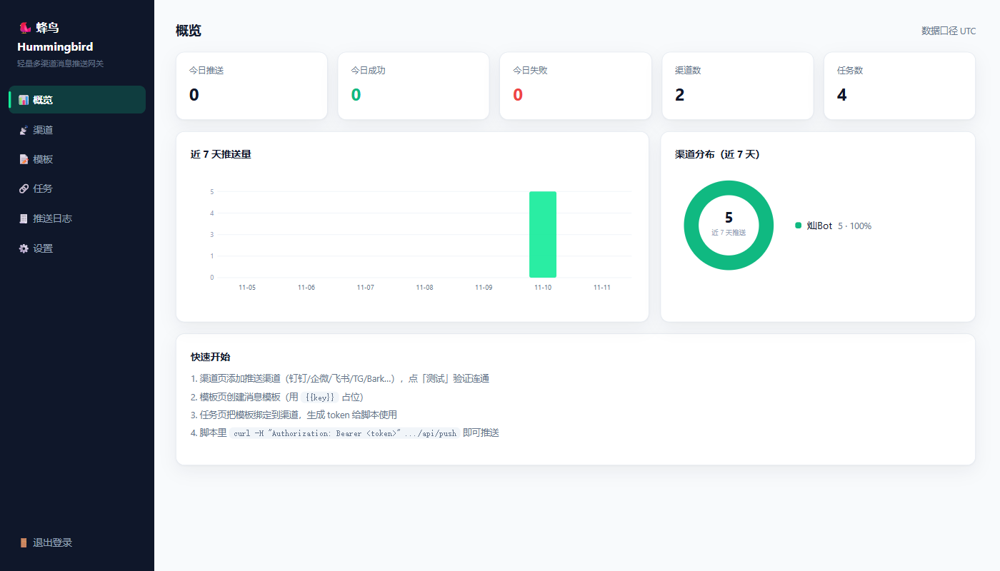
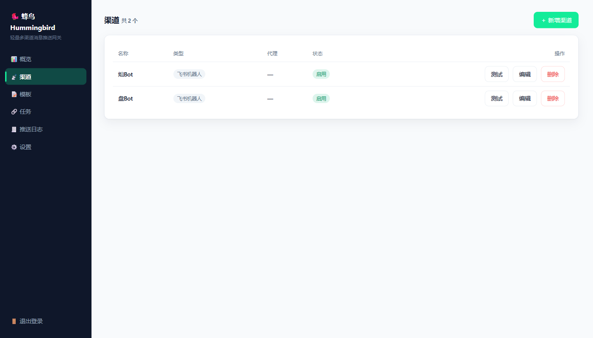
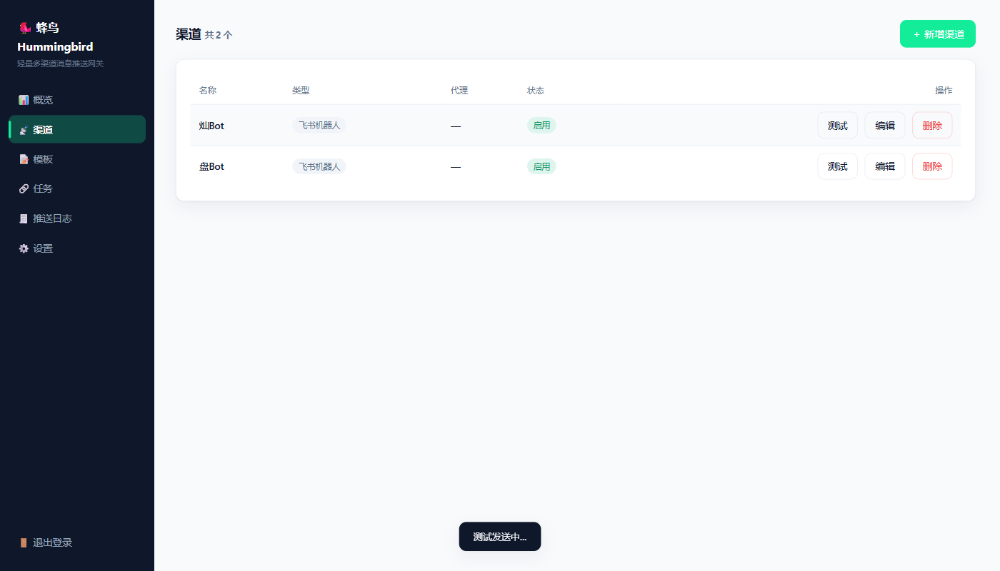
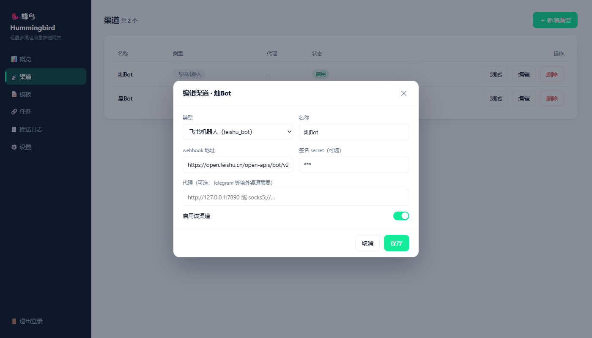
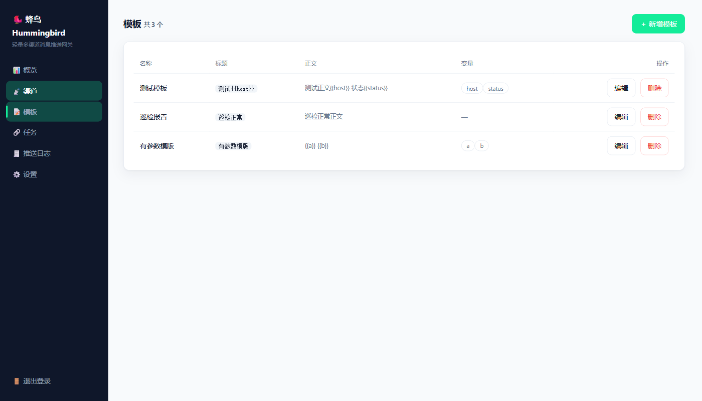
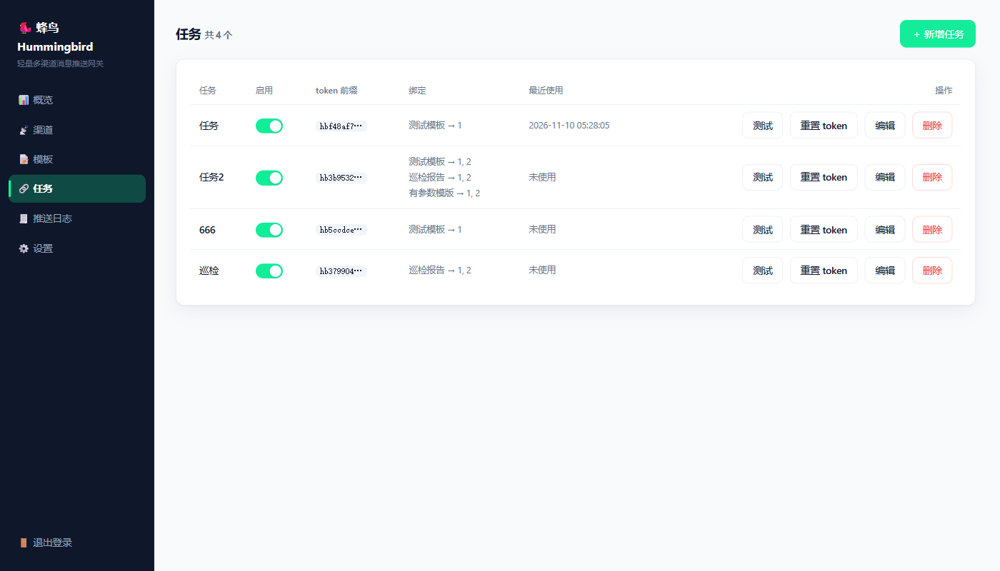
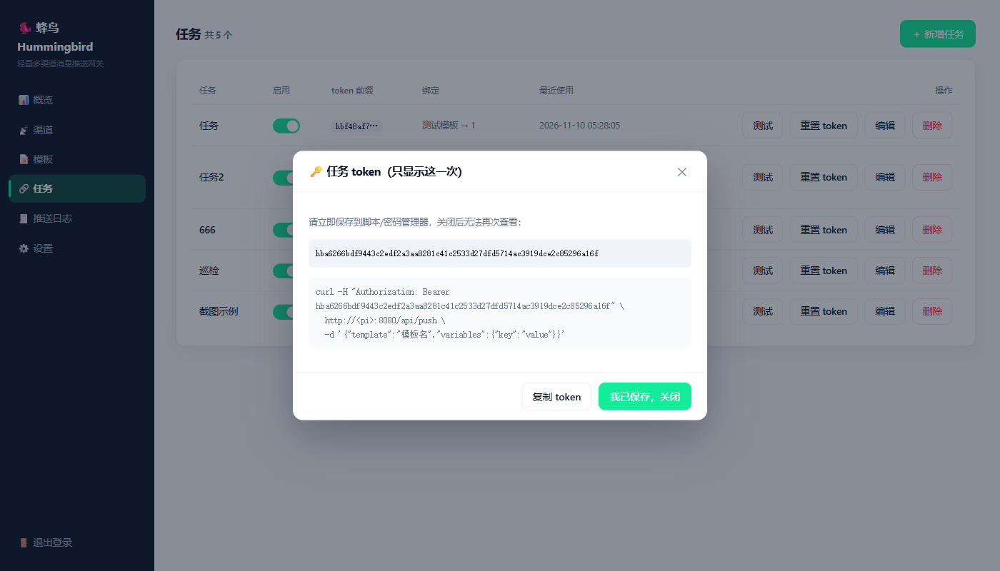
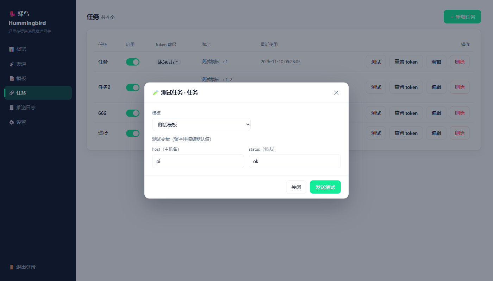
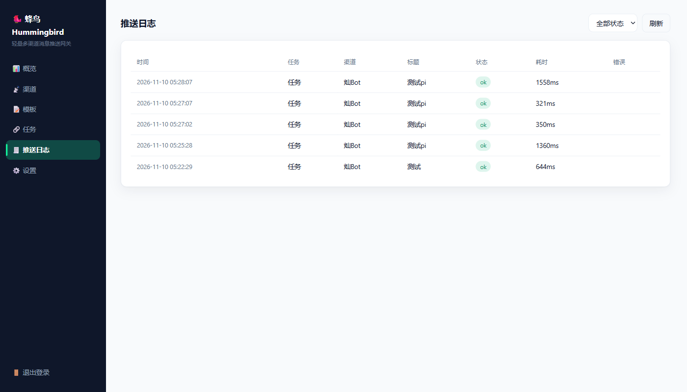
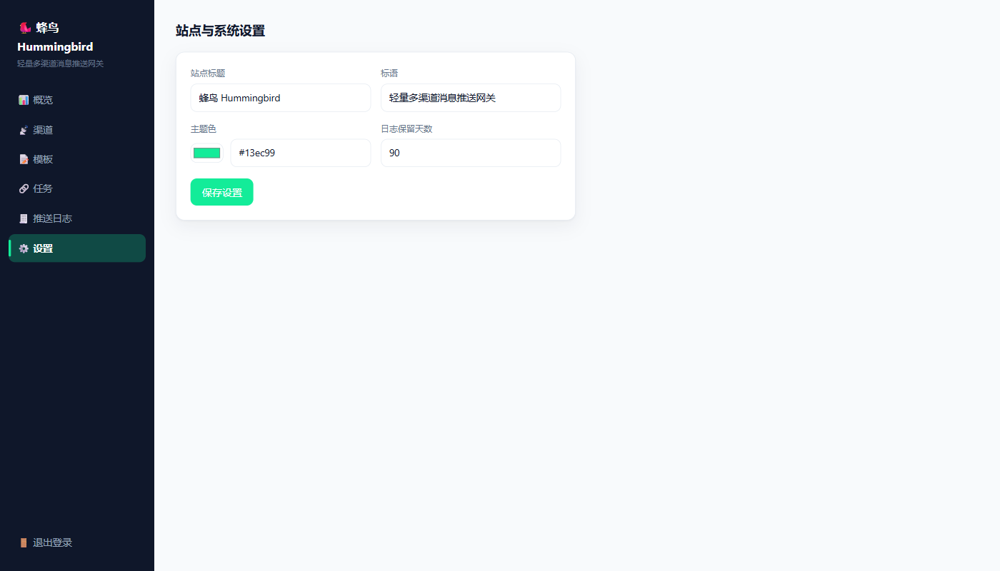

<div align="center">

# 🐦 Hummingbird

**A multi-channel notification gateway that sips memory**

[](https://github.com/canyuda/hummingbird/releases/latest)
[](https://github.com/canyuda/hummingbird/actions/workflows/build.yml)
[](LICENSE)


[中文](README.md) · **English**

</div>

---

Hummingbird is a self-hosted notification gateway: a **3 MB** single binary (Web console embedded) that idles at **7.5 MB** RSS and runs comfortably on tiny boxes like a Raspberry Pi 3B+ (1 GB). Your scripts, cron jobs and monitors call one HTTP endpoint — templating, multi-channel fan-out, proxying and logging are all handled for you.

## 📸 Screenshots



<details>
<summary>More screenshots (channels / channel modal / channel test / templates / tasks / task test modal / logs / settings)</summary>

| | |
|---|---|
|  |  |
|  |  |
|  |  |
|  |  |
|  | |

</details>

## ✨ Why Hummingbird

- 🧠 **7.5 MB idle RSS** — synchronous Rust stack (tiny_http + ureq + rusqlite), no resident background threads
- 📦 **3 MB single binary** — the frontend build is embedded; deploy by copying one file
- 🍓 **Built for small devices** — verified on a Raspberry Pi 3B+ (1 GB), single-file SQLite storage, zero external dependencies

| Metric | Target | Measured (macOS arm64) |
|---|---|---|
| Idle RSS | < 8 MB | **7.5 MB** |
| Binary size (frontend embedded) | < 10 MB | **3.0 MB** |
| Unit tests | — | 12/12 passed |
| End-to-end tests | — | 44/44 passed |

## 📮 Supported Channels

DingTalk Bot · WeCom Bot · WeCom App (delivers straight into WeChat) · Feishu (Lark) Bot · Telegram · Bark · ntfy · generic webhook

Each channel can use its own HTTP proxy (e.g. Telegram via a local [mihomo](https://github.com/MetaCubeX/mihomo) instance).

## 🚀 Quick Start

**1. Build and run** (the repo ships prebuilt frontend assets, so building the backend is enough; prebuilt binaries are on the [Releases](https://github.com/canyuda/hummingbird/releases/latest) page: linux-amd64 / arm64 / armv7, windows-amd64, macos-arm64)

```bash
cargo build --release
./target/release/hummingbird
```

On first start the initial admin password is printed to stdout (once). Open `http://<host>:8080`, sign in, and you'll be asked to change it.

**2. Configure in the Web console**: add channels → write templates (`{{var}}` variables with defaults) → create a task binding "template → channel group" and get its token.

**3. Push** — callers only send a template and its variables; which channels deliver it is decided by the task binding:

```bash
# Single message
curl -X POST http://<host>:8080/api/push \
  -H "Authorization: Bearer <task-token>" \
  -H "Content-Type: application/json" \
  -d '{"template": "inspection", "variables": {"host": "pi", "status": "ok"}}'

# Batch (up to 20 per call)
curl -X POST http://<host>:8080/api/push \
  -H "Authorization: Bearer <task-token>" \
  -H "Content-Type: application/json" \
  -d '{"messages": [
        {"template": "inspection", "variables": {"host": "pi"}},
        {"template": "alert", "variables": {"host": "db", "level": "high"}}
      ]}'

# One-liner (GET), handy for cron / scripts
curl "http://<host>:8080/push/<task-token>?template=inspection&host=pi&status=ok"
```

> **Task model**: a task = a token (1:1) plus "template → channel group" bindings. Callers cannot choose channels, so a leaked token has the smallest possible blast radius.

## ⚙️ Configuration

| Env var | Default | Description |
|---|---|---|
| `HB_PORT` | `8080` | HTTP listen port (`0.0.0.0`) |
| `HB_DB_PATH` | `./hummingbird.db` | SQLite database file path |

```bash
HB_DB_PATH=/data/hb.db HB_PORT=9000 ./hummingbird   # run in foreground
./hummingbird reset-password                        # reset the admin password (printed to stdout)
```

Push logs are pruned automatically (lazy), no maintenance needed.

## 🔄 Upgrade / Backup / Uninstall

**Upgrade** — one command on the Pi (detects the architecture → downloads → verifies sha256 → backs up the old binary as `hummingbird.bak` → replaces and restarts the service; data untouched):

```bash
curl -fsSL https://raw.githubusercontent.com/canyuda/hummingbird/main/scripts/upgrade.sh | sudo bash
# Pin a version: sudo bash upgrade.sh v0.1.4
# Faster in CN: curl -fsSL … | sudo env HB_GH_PROXY=https://ghproxy.net/ bash
```

**Backup** — every setting and log lives in a single SQLite file; copy it away (stop the service first):

```bash
sudo systemctl stop hummingbird
sudo cp /opt/hummingbird/hummingbird.db ~/backup/
sudo systemctl start hummingbird
```

**Uninstall**:

```bash
sudo systemctl disable --now hummingbird
sudo rm /etc/systemd/system/hummingbird.service && sudo systemctl daemon-reload
sudo rm -rf /opt/hummingbird     # removes data too — copy the .db out first if you want to keep it
```

See the [deployment guide](docs/自研消息网关部署指南.md) and [runtime defaults & autostart](docs/自研消息网关运行时默认与自启动.md) (Chinese) for full operations coverage.

## 📦 Build & Cross-Compilation

```bash
cargo build --release            # native binary at target/release/hummingbird

# Only needed when you change the frontend (assets get embedded into the binary)
cd web && npm install && npm run build && cd ..

# Cross-compile for Raspberry Pi (requires: cargo install cargo-zigbuild && brew install zig)
rustup target add aarch64-unknown-linux-musl armv7-unknown-linux-musleabihf
cargo zigbuild --release --target aarch64-unknown-linux-musl      # 64-bit systems
cargo zigbuild --release --target armv7-unknown-linux-musleabihf  # 32-bit systems
```

## 🔐 Security

- argon2id password hashing (tuned to m=8MiB) + session cookies
- Two-dimensional brute-force lockout (per IP + per account)
- Task tokens stored as SHA-256 hashes only
- Channel secrets masked in API responses

## 🧪 Testing

```bash
cargo test            # unit tests (renderer / channel validation / HMAC / URL encoding)
bash tests/e2e.sh     # end-to-end: boots the server + a local webhook receiver, 44 assertions (incl. memory)
```

## 📁 Project Layout

<details>
<summary>Expand</summary>

```
hummingbird/
├── Cargo.toml               # workspace + memory-frugal release profile
├── crates/server/           # backend (tiny_http + ureq + rusqlite, synchronous stack)
│   ├── src/main.rs          # entry point + routing
│   ├── src/db.rs            # SQLite single connection + DDL + bootstrap
│   ├── src/auth.rs          # argon2 / tokens / brute-force lockout
│   ├── src/api_auth.rs      # login/logout/password APIs
│   ├── src/api_admin.rs     # channels/templates/tasks/settings/logs APIs
│   ├── src/channels.rs      # 8 channel implementations + proxy agent cache
│   ├── src/push.rs          # push pipeline (render → bind → fan-out → log)
│   ├── src/tmpl.rs          # {{var}} template renderer
│   └── src/http.rs          # HTTP infrastructure
├── web/                     # Vue3 console (build output embedded into the binary)
├── docs/                    # design doc / deployment guide / screenshots (Chinese)
└── tests/e2e.sh             # end-to-end tests
```

</details>

## 📚 Documentation (Chinese)

- [Design document](docs/自研消息网关设计文档.md) (v0.8)
- [Deployment guide](docs/自研消息网关部署指南.md)
- [Runtime defaults & autostart](docs/自研消息网关运行时默认与自启动.md)

## 📄 License

[MIT](LICENSE) © 2026 canyuda
