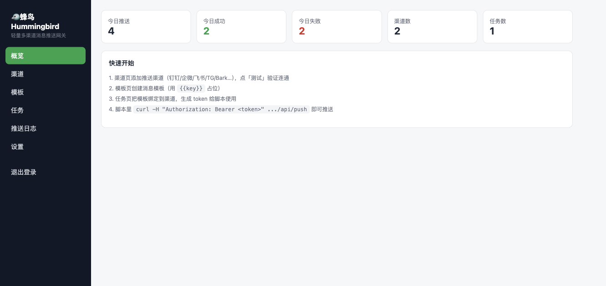
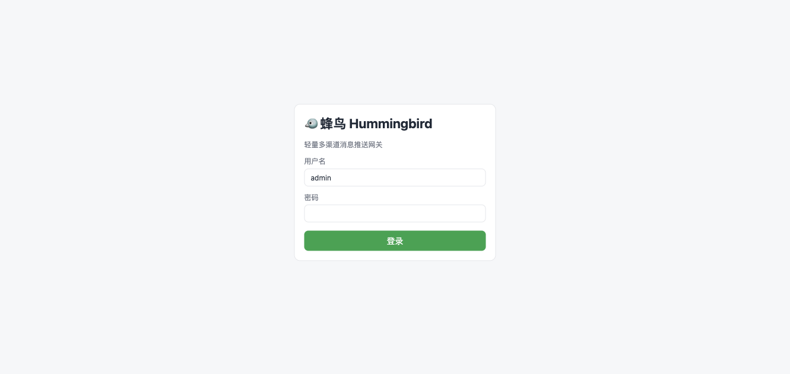
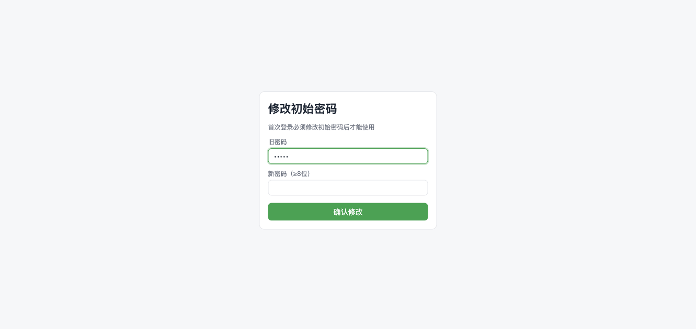
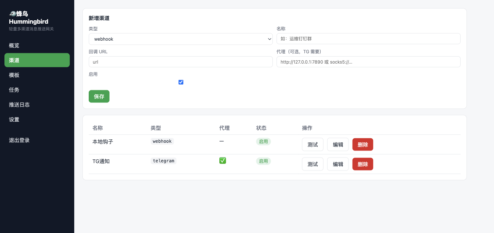
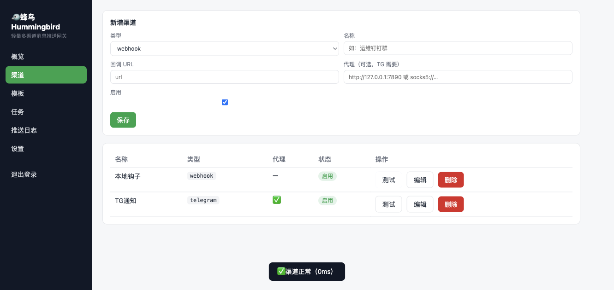
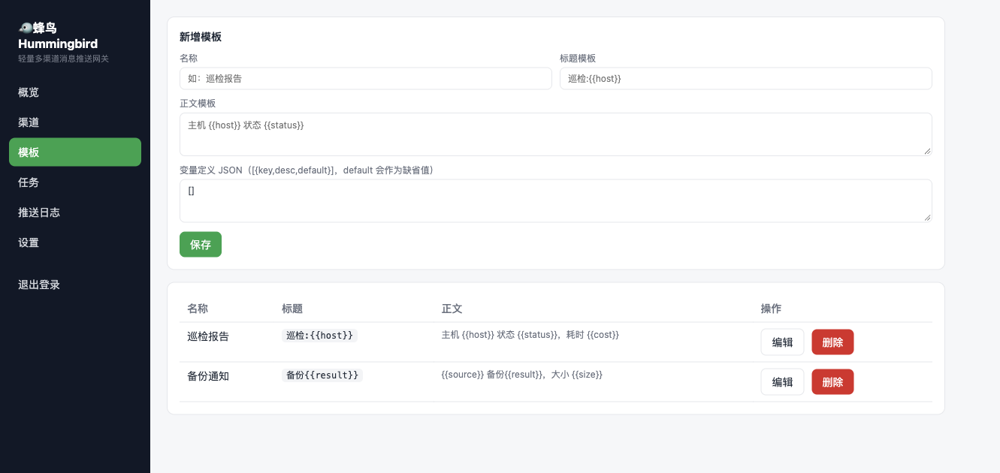
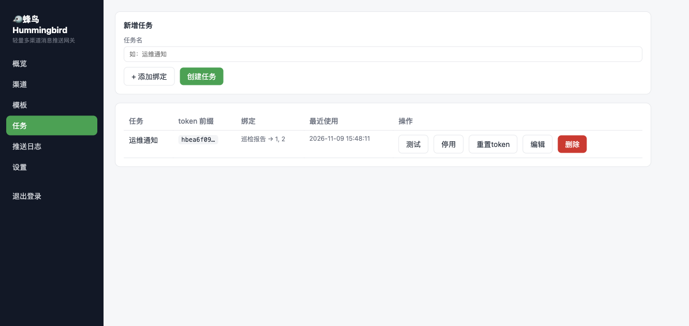
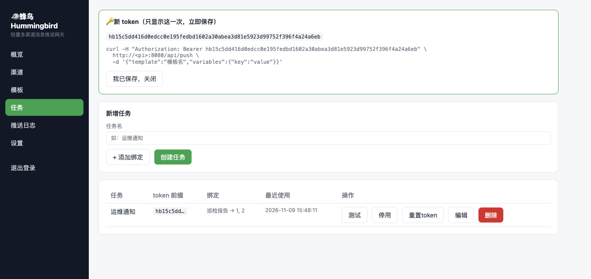
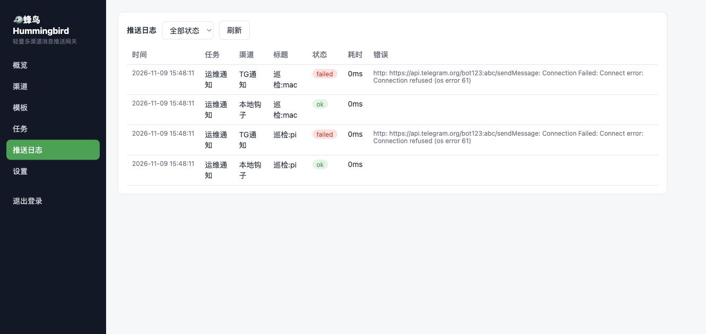
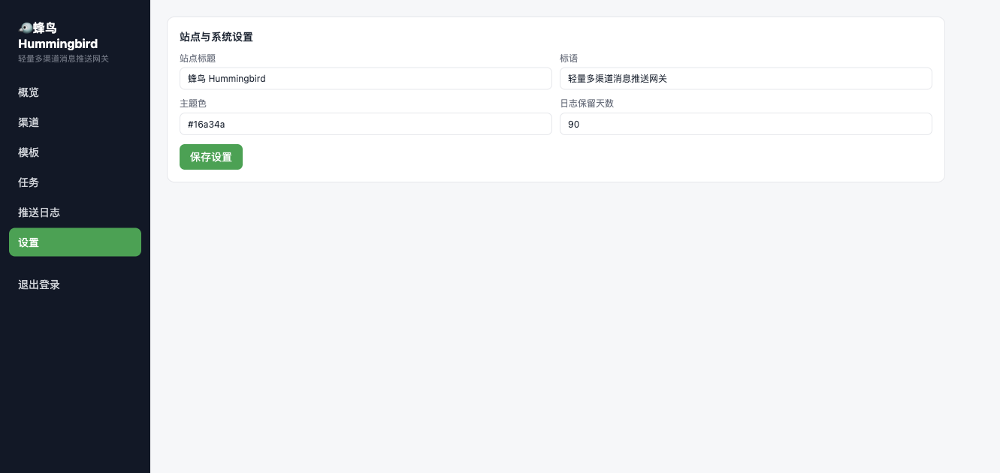

<div align="center">

# 🐦 蜂鸟 Hummingbird

**为小内存设备而生的多渠道消息推送网关**

[](LICENSE)


**中文** · [English](README.en.md)

</div>

---

蜂鸟是一个自托管的消息推送网关：一个 **3 MB** 的单文件二进制（Web 管理台已内嵌），常驻内存仅 **7.5 MB**，在树莓派 3B+（1 GB 内存）这样的小设备上稳跑。脚本、定时任务、监控系统只管调一个 HTTP 接口，剩下的事——模板渲染、多渠道分发、代理、日志——都交给它。

## 📸 界面预览



<details>
<summary>更多截图（登录 / 首登改密 / 渠道 / 模板 / 任务 / 日志 / 设置）</summary>

| | |
|---|---|
|  |  |
|  |  |
|  |  |
|  |  |
|  | |

</details>

## ✨ 为什么是蜂鸟

- 🧠 **7.5 MB 常驻内存** —— 同步 Rust 栈（tiny_http + ureq + rusqlite），无常驻后台线程
- 📦 **3 MB 单二进制** —— 前端构建产物直接内嵌，`scp` 一个文件即完成部署
- 🍓 **为小设备而生** —— 树莓派 3B+（1 GB）实测可跑，SQLite 单文件存储，零外部依赖

| 指标 | 目标 | 实测（macOS arm64） |
|---|---|---|
| 常态空闲 RSS | < 8 MB | **7.5 MB** |
| 二进制体积（含内嵌前端） | < 10 MB | **3.0 MB** |
| 单元测试 | — | 12/12 通过 |
| 端到端自动化测试 | — | 44/44 通过 |

## 📮 支持的渠道

钉钉机器人 · 企微机器人 · 企微应用（直达微信）· 飞书机器人 · Telegram · Bark · ntfy · 通用 webhook

每个渠道可单独配置 HTTP 代理（例如 Telegram 走本机 [mihomo](https://github.com/MetaCubeX/mihomo)）。

## 🚀 快速开始

**1. 构建并运行**（仓库已带前端构建产物，直接编译后端即可；预编译二进制将发布在 Releases 页）

```bash
cargo build --release
./target/release/hummingbird
```

首次启动会在 stdout 打印 admin 初始密码（仅一次），浏览器打开 `http://<host>:8080` 登录后强制改密。

**2. 在 Web 管理台完成配置**：添加渠道 → 编写模板（`{{var}}` 变量 + 默认值）→ 创建任务并绑定"模板 → 渠道组"，拿到任务 token。

**3. 发起推送**——调用方只传模板和变量，发到哪些渠道由任务绑定决定：

```bash
# 单发
curl -X POST http://<host>:8080/api/push \
  -H "Authorization: Bearer <任务token>" \
  -H "Content-Type: application/json" \
  -d '{"template": "巡检", "variables": {"host": "pi", "status": "ok"}}'

# 批量（单次 ≤ 20 条）
curl -X POST http://<host>:8080/api/push \
  -H "Authorization: Bearer <任务token>" \
  -H "Content-Type: application/json" \
  -d '{"messages": [
        {"template": "巡检", "variables": {"host": "pi"}},
        {"template": "告警", "variables": {"host": "db", "level": "high"}}
      ]}'

# 一行流（GET），适合 cron / 脚本
curl "http://<host>:8080/push/<任务token>?template=巡检&host=pi&status=ok"
```

> **任务模型**：任务 = token（1:1）+ 若干"模板 → 渠道组"绑定。调用方无法指定渠道，token 泄露时爆炸半径最小。

## ⚙️ 配置

| 环境变量 | 默认值 | 说明 |
|---|---|---|
| `HB_PORT` | `8080` | HTTP 监听端口（`0.0.0.0`） |
| `HB_DB_PATH` | `./hummingbird.db` | SQLite 数据库文件路径 |

```bash
HB_DB_PATH=/data/hb.db HB_PORT=9000 ./hummingbird   # 前台运行
./hummingbird reset-password                        # 重置 admin 密码（打印到 stdout）
```

推送日志自动清理（懒触发），无需额外维护。

## 📦 构建与交叉编译

```bash
cargo build --release            # 本机可执行文件 target/release/hummingbird

# 修改前端时才需要重新构建（产物会内嵌进二进制）
cd web && npm install && npm run build && cd ..

# 树莓派交叉编译（需先: cargo install cargo-zigbuild && brew install zig）
rustup target add aarch64-unknown-linux-musl armv7-unknown-linux-musl
cargo zigbuild --release --target aarch64-unknown-linux-musl   # 64 位系统
cargo zigbuild --release --target armv7-unknown-linux-musl     # 32 位系统
```

## 🔐 安全

- argon2id 口令哈希（m=8MiB 调参）+ session cookie
- 防爆破双维度锁定（IP + 账号）
- 任务 token 仅存 SHA-256 哈希
- 渠道 secret 字段接口脱敏返回

## 🧪 测试

```bash
cargo test            # 单元测试（渲染器 / 渠道校验 / HMAC / URL 编码）
bash tests/e2e.sh     # 端到端自动化：起服务 + 本地 webhook 接收器，44 项断言（含内存指标）
```

## 📁 目录结构

<details>
<summary>展开</summary>

```
hummingbird/
├── Cargo.toml               # workspace + 极致省内存 release profile
├── crates/server/           # 后端（tiny_http + ureq + rusqlite，同步栈）
│   ├── src/main.rs          # 入口 + 路由分发
│   ├── src/db.rs            # SQLite 单连接 + DDL + 引导
│   ├── src/auth.rs          # argon2 / token / 防爆破锁定
│   ├── src/api_auth.rs      # 登录/登出/改密 API
│   ├── src/api_admin.rs     # 渠道/模板/任务/设置/日志 API
│   ├── src/channels.rs      # 8 渠道实现 + 代理 Agent 缓存
│   ├── src/push.rs          # 推送管线（渲染→绑定→并行发送→日志）
│   ├── src/tmpl.rs          # {{var}} 模板渲染器
│   └── src/http.rs          # HTTP 基础设施
├── web/                     # Vue3 管理台（构建产物内嵌进二进制）
├── docs/                    # 设计文档 / 部署指南 / 截图
└── tests/e2e.sh             # 端到端自动化测试
```

</details>

## 📚 更多文档

- [设计文档](docs/自研消息网关设计文档.md)（v0.8）
- [部署指南](docs/自研消息网关部署指南.md)
- [运行时默认与自启动](docs/自研消息网关运行时默认与自启动.md)

## 📄 License

[MIT](LICENSE) © 2026 canyuda
